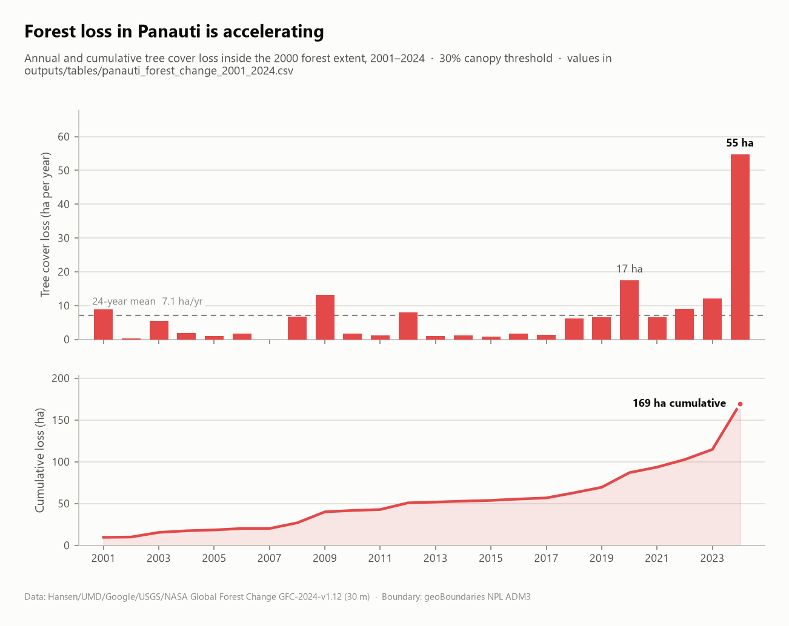
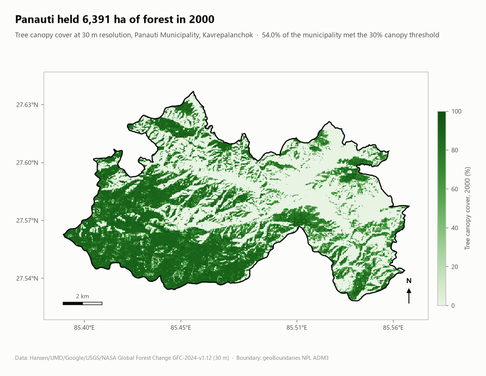
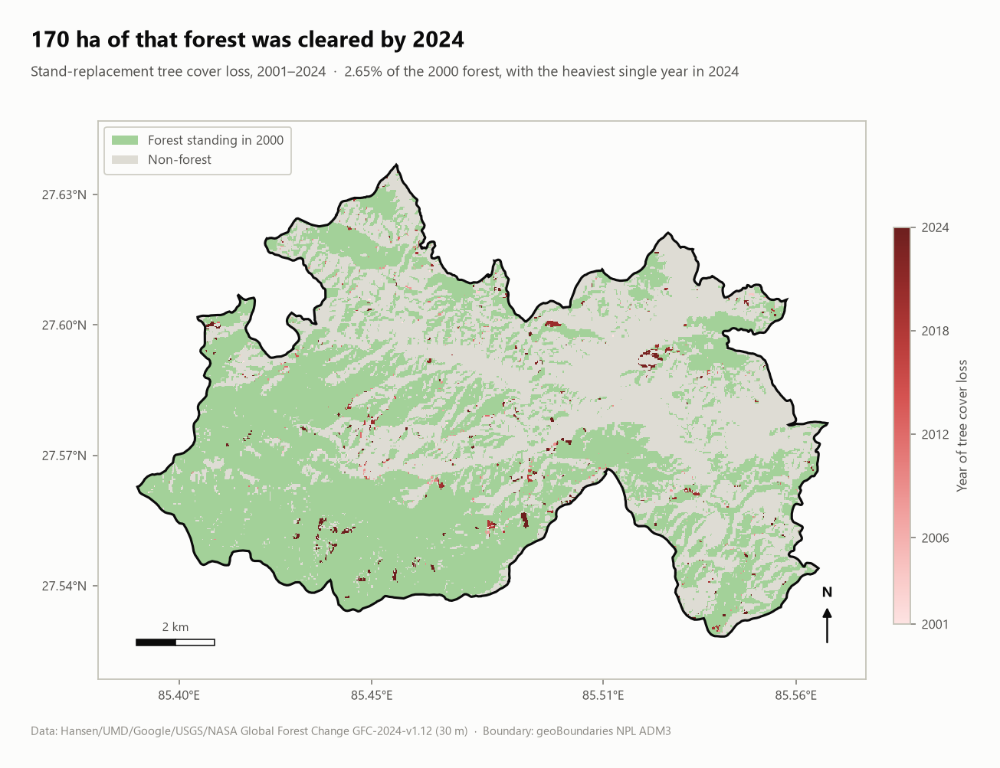
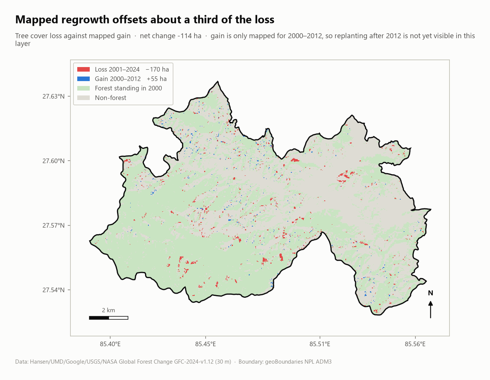

# Mission Panauti — Forest Change Mapping

Open, reproducible GIS analysis of deforestation and regrowth in **Panauti
Municipality, Kavrepalanchok, Nepal**, built to give the local reforestation
effort a baseline it can measure against.

Four Python steps take the project from nothing to finished maps: fetch the
municipal boundary, clip 30 m satellite forest-change rasters straight out of
the Hansen Global Forest Change archive, turn them into per-year area
statistics, and render the map sheets and chart below.

---

## What the data shows

| | |
|---|---|
| Municipal area | **11,833 ha** |
| Forest in 2000 (≥30 % canopy) | **6,391 ha** — 54.0 % of the municipality |
| Tree cover lost, 2001–2024 | **169.5 ha** — 2.65 % of the 2000 forest |
| Tree cover gained, 2000–2012 | **55.1 ha** |
| Net change | **−114.3 ha** |
| Mean annual loss | **7.1 ha/yr** |
| Heaviest year | **2024** — 54.7 ha, nearly 8× the long-run mean |
| Forest remaining, 2024 | **6,221 ha** |

Loss is not spread evenly through the period. Clearing ran below the long-run
mean for most of 2001-2019; four of the five years from 2020 onward sit above
it, and 2024 alone accounts for 32% of everything lost since 2001.

<picture>
  <source media="(prefers-color-scheme: dark)" srcset="outputs/maps/annual-loss-dark.png">
  
</picture>

## Maps

**Baseline — tree canopy cover in 2000.** Dense canopy holds the hills in the
south and west of the municipality. A pale corridor of low cover runs
west-north-west to east-south-east through the middle — the cultivated valley
and the Panauti township itself.

<picture>
  <source media="(prefers-color-scheme: dark)" srcset="outputs/maps/forest-cover-2000-dark.png">
  
</picture>

**Where and when forest was lost.** Each coloured patch is a 30 m pixel that
went from forest to non-forest, shaded by the year it happened. Clearing is an
edge process here: **59%** of loss pixels sit directly against non-forest land,
against **25%** of forest pixels overall — it eats inward from the margins and
the tracks rather than opening holes deep inside the blocks.

<picture>
  <source media="(prefers-color-scheme: dark)" srcset="outputs/maps/forest-loss-by-year-dark.png">
  
</picture>

**Loss against regrowth.** Mapped gain offsets roughly a third of the loss by
area, but it is not the cleared ground growing back: **93%** of gain pixels fall
on land that was already below the canopy threshold in 2000, and only 15 pixels
in the whole municipality record both loss and gain. Regrowth is happening
somewhere else from the clearing.

<picture>
  <source media="(prefers-color-scheme: dark)" srcset="outputs/maps/loss-and-gain-dark.png">
  
</picture>

## Tables

Every number above comes out of the pipeline, not out of a spreadsheet by hand:

- [`outputs/tables/panauti_forest_change_2001_2024.csv`](outputs/tables/panauti_forest_change_2001_2024.csv)
  — one row per year: loss, cumulative loss, forest remaining, share of the
  2000 forest, annual loss rate.
- [`outputs/tables/panauti_forest_change_2001_2024.xlsx`](outputs/tables/panauti_forest_change_2001_2024.xlsx)
  — the same series plus a summary sheet, for stakeholders who work in Excel.
- [`outputs/tables/summary.json`](outputs/tables/summary.json) — the headline
  figures, machine-readable.

## Method

1. **Boundary.** Panauti's ADM3 polygon is cut out of the geoBoundaries Nepal
   layer and stored as `data/panauti.geojson`.
2. **Rasters.** The Hansen tiles are 40,000 × 40,000 px and ~250 MB each. Rather
   than download them, GDAL's `/vsicurl` driver reads only the ~800 × 515 px
   window covering Panauti over HTTP range requests, and the four clips land in
   `data/raster/` at well under 1 MB in total.
3. **Statistics.** A pixel counts as forest in 2000 at **≥30 % canopy cover** —
   the threshold Global Forest Watch uses for its headline figures, so these
   numbers are comparable to GFW's national dashboards. Loss is counted only
   inside that baseline mask, and permanent water is excluded via the Hansen
   `datamask` layer.
4. **Area.** Cells in a lat/lon grid shrink towards the poles, so a single
   pixel-area constant would bias the totals. Areas are accumulated per raster
   row from the exact spherical-quadrilateral area of that row's cells.
5. **Cartography.** Map sheets carry a graticule, scale bar, north arrow and
   source note. Sequential ramps are single-hue with strictly monotonic
   lightness; loss and gain use a red/blue pair that stays separable under
   protanopia, deuteranopia and tritanopia. Every figure renders for a light and
   a dark surface.

## Reproducing it

```bash
pip install -r requirements.txt

python src/fetch_boundary.py         # geoBoundaries ADM3 -> data/panauti.geojson
python src/fetch_forest_rasters.py   # Hansen GFC -> data/raster/*.tif
python src/analyze_forest_change.py  # -> outputs/tables/
python src/make_maps.py              # -> outputs/maps/
```

Steps 1 and 2 need network access; steps 3 and 4 run entirely offline against
the committed clips. The whole pipeline takes well under a minute.

## Repository layout

```
data/
  panauti.geojson          municipal boundary (committed)
  raster/                  Hansen GFC clipped to Panauti (committed, <1 MB)
src/
  config.py                paths, dataset version, canopy threshold
  geo.py                   boundary masking and latitude-aware pixel areas
  fetch_boundary.py        step 1
  fetch_forest_rasters.py  step 2
  analyze_forest_change.py step 3
  make_maps.py             step 4
  viz_theme.py             palette and figure styling
outputs/
  maps/                    map sheets and chart, light and dark
  tables/                  CSV, XLSX and JSON results
```

## Limitations

- Hansen **loss** means stand-replacement disturbance of any cause — logging,
  landslide, fire, road building, a plot cleared for construction. It is not by
  itself evidence of illegal felling, and in a monsoon district a mass-wasting
  year can move the number sharply.
- Hansen **gain** is only mapped for 2000–2012. Reforestation planted after
  2012 will not appear here, so the net figure understates recent recovery.
  Confirming young plantings needs a higher-resolution or field-survey layer.
- At 30 m, thin roadside strips and small agroforestry plots fall below what a
  pixel can resolve.
- The 30 % canopy threshold is a choice. A stricter threshold reduces both the
  baseline and the measured loss; `CANOPY_THRESHOLD` in `src/config.py` makes it
  a one-line change.

## Data sources

- Hansen, M. C., P. V. Potapov, R. Moore, M. Hancher, et al. (2013).
  "High-Resolution Global Maps of 21st-Century Forest Cover Change."
  *Science* 342 (6160): 850–853. Data: Global Forest Change GFC-2024-v1.12,
  accessed via the Earth Engine partners archive.
- Runfola, D. et al. (2020). "geoBoundaries: A global database of political
  administrative boundaries." *PLoS ONE* 15(4): e0231866. Nepal ADM3.

## Licence

Code released under the [MIT Licence](LICENSE). The Hansen GFC and
geoBoundaries datasets remain under their own terms (CC-BY 4.0 and ODbL /
CC-BY respectively) — cite them if you reuse the derived layers.
